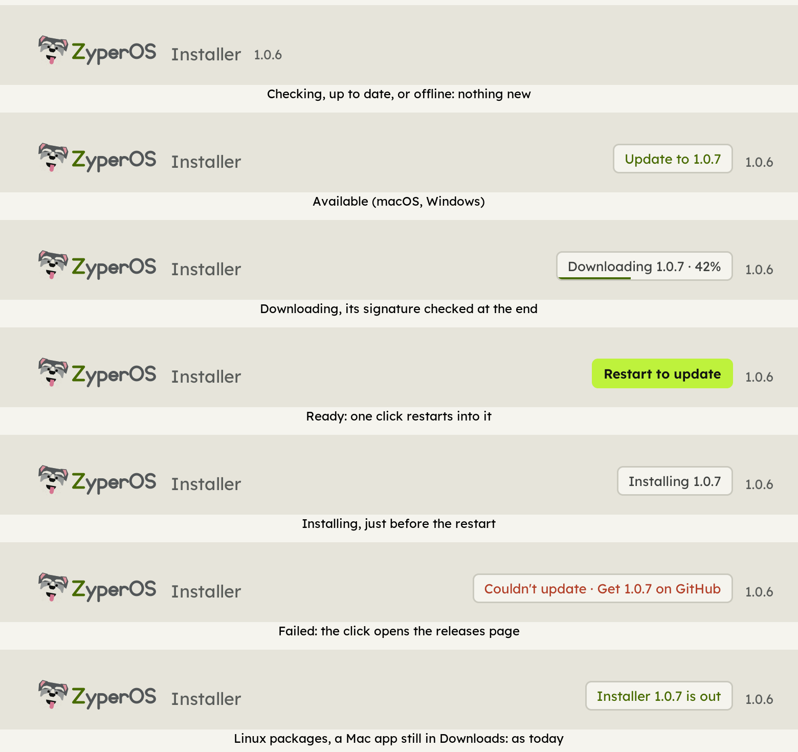
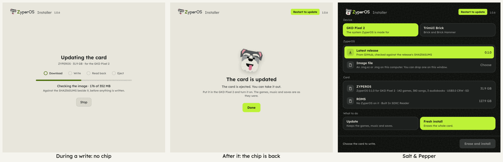

# ZyperOS Installer updates itself

2026-11-14. Branch `installer-selfupdate`. For the release after 1.0.5.

Until now the installer looked for a newer version on open and showed a chip, "Installer 1.0.6 is
out", that opened the releases page. From here on, on macOS and Windows the chip updates the
installer in place: it downloads the new one, checks its signature, and restarts into it. It uses
Tauri's official updater plugin (`tauri-plugin-updater` 2.14).

## The chip, state by state

The chip sits in the header, left of the version, where today's chip is. It never takes over the
window: the update is a notice, and the card is what the window is for.

(The page in a browser, in demo mode: `ui/?release&update=available`, and `downloading`, `ready`,
`installing`, `failed`, `page`.)

| State | Chip | Its click |
|---|---|---|
| Checking (on open, once) | none | |
| Up to date, offline, or GitHub not answering | none | |
| Available (macOS, Windows) | **Update to 1.0.7**, accent ink on surface, as today's chip | starts the download |
| Downloading | **Downloading 1.0.7 · 42%**, a line under the words growing with it | nothing (disabled) |
| Ready: downloaded, signature checked | **Restart to update**, the accent as a fill, as the primary button | puts the new app in place and opens it |
| Installing (a second, before the restart) | **Installing 1.0.7** | nothing (disabled); the write button waits too |
| Failed (download, signature or install) | **Couldn't update · Get 1.0.7 on GitHub**, in warning's color; the reason in its tooltip | opens the releases page: the old way |
| Can't update in place (Linux `.deb`/`.rpm`, a Mac app run from Downloads) | **Installer 1.0.7 is out**, exactly as today | opens the releases page |

Choices, and why:

- **Two clicks, never a restart by itself.** "Update to 1.0.7" downloads; "Restart to update"
  restarts. The window never reloads under the hand of someone picking a card, and the restart is
  always a click away once the file is ready.
- **Checking shows nothing.** The check takes well under a second and fails quietly offline, as
  today's does: a "Checking for updates" that flashes on every open is noise.
- **Never during a write.** The chip is hidden on the write's screen, whatever its state; a
  download already going carries on (it doesn't touch the card) and "Restart to update" shows once
  the write is over. The app also refuses the restart while a card is being written, and refuses to
  start a write while it is installing the update.
- **Linux keeps today's chip.** The `.deb` and `.rpm` were installed by the system's package manager
  and belong to it; the words stay "Installer 1.0.7 is out", which reads naturally with no mention
  of Linux. (The plugin 2.14 can run `dpkg -i`/`rpm -U` through `pkexec`; not used here.)
- **A Mac app still in Downloads** runs from a read-only copy macOS makes (App Translocation), which
  can't be replaced: that case gets today's chip, and its tooltip says to move the app to
  Applications.

## How it works

- **Where it looks:** `https://github.com/tarikbc/ZyperOS/releases/latest/download/latest.json`.
  GitHub's "latest" never names a draft or a pre-release, as the installer's own release check
  already assumes. A release without a `latest.json` (1.0.5 and before), or a check that fails for
  any reason, falls back to that release check: today's chip.
- **What `latest.json` names:** `darwin-aarch64` and `darwin-x86_64` (the same universal app,
  `ZyperOS-Installer-<v>-macOS-update.tar.gz`, made by Tauri's `createUpdaterArtifacts`) and
  `windows-x86_64` (the portable `ZyperOS-Installer-<v>-Windows.exe` itself), each with its
  signature. No Linux entry: the plugin reads the whole file, so only what is there is listed.
- **Signatures:** a minisign key made with `tauri signer generate`. The public key is in
  `tauri.conf.json`; the private one stays on Tarik's Mac (`~/.config/zyperos/installer-updater.key`)
  and in the repository secret `INSTALLER_UPDATER_KEY`, which only a release tag's build reads.
  `requireSignedVersion` is on: the version is inside the signature, so an edited `latest.json`
  can't pair a new version number with an older, validly signed file.
- **macOS:** the plugin's own install: the new `.app` is unpacked next to the old one and swapped in
  one step (APFS `renamex_np`), asking for an administrator's password only when the app's folder
  isn't writable. Then the app restarts.
- **Windows:** the plugin installs NSIS and MSI installers only, and the Windows download is a
  portable exe, which stays. So the plugin checks, downloads and verifies, and the installer swaps
  its own exe: the running file is renamed to `<name>.old` (Windows allows renaming a running exe,
  not deleting it), the new one takes its name, and the app restarts. A failed swap puts the old one
  back. The `.old` file is removed on the next start. The file keeps its name, so shortcuts work.
- **The first in-place update** is from the first installer that has this to the release after it.
  Installers up to 1.0.5 show today's chip for that one update.

## The release

`release.yml` on the tag: the macOS job builds the app with updater artifacts, signed with the key
from the secret; the Windows job signs the exe (`tauri signer sign --app-version`); the publish job
checks every signature against the public key in `tauri.conf.json` with `minisign` (a wrong secret
stops the release before anything is uploaded), writes `latest.json` with
`installer/tools/latest-json.py`, and uploads it with the files. A pull request that changes
`release.yml` does all of this with a throwaway key made in the run, and uploads nothing.

## Tests

- The version compare the plugin is given, and the fallback's.
- `latest-json.py`'s file, read by the plugin's own `RemoteRelease`: each platform finds its file and
  signature; Linux finds none.
- The Windows swap, on any system: the new file in place, the old one kept aside, the old one back
  when the swap fails, a leftover `.old` removed.
- On this Mac, end to end with a local server and a test key: an app at version A updated to B, and
  what macOS does with the new app (its attributes, Gatekeeper's verdict, whether it opens).
  `installer/tools/try-selfupdate.sh` does it again.

## What macOS does, measured (2026-11-14, macOS 27.2, Apple Silicon)

- **An updated app carries no quarantine mark.** Debug builds 1.0.0 and 1.0.1 of this branch, signed
  with a test key, `latest.json` on 127.0.0.1. Opened through LaunchServices, 1.0.0 found 1.0.1,
  downloaded it (11.9 MB), checked its signature, swapped itself and opened again as 1.0.1. Twice:
  once as built, once with every file of the old app marked `com.apple.quarantine`
  `01c1;…;Safari;…`, the "downloaded, and the user allowed it" mark every app this Mac got from a
  browser and opened carries. Both times the new bundle had no `com.apple.quarantine` on any file,
  only `com.apple.provenance` (which every file a process writes gets). syspolicyd's log has
  Gatekeeper look at the quarantined old app with its quarantine fields set (`1, 1, 1, 0, 8`) and at
  the new one with them clear (`0, 0, 1, 0, 8`), as for an app never downloaded: no prompt, and it
  opened. The updater downloads with its own HTTP client and writes the files itself, and the app
  doesn't ask macOS to mark its files (no `LSFileQuarantineEnabled`), so nothing marks them.
- **A first install is as before.** The release build of this branch (universal, as `release.yml`
  makes it) against the published 1.0.5 app: the same files in the bundle, the same `Info.plist`,
  the same ad-hoc linker signature, and the same Gatekeeper verdict (`spctl`: "rejected, no usable
  signature"), so the same *Open Anyway* the first time. `createUpdaterArtifacts` changes nothing
  in the app: the binary built with it is byte for byte the one built without, and the `.tar.gz`
  holds exactly that app. The release build opens (hidden, `open -g -j`).
- **Not tried:** an app in a folder the user can't write to (the updater asks for an
  administrator's password through AppleScript); a translocated app (refused before the update, see
  above); Windows, which has no machine here (the swap is tested on any system with files, and
  Windows CI builds and tests it).
